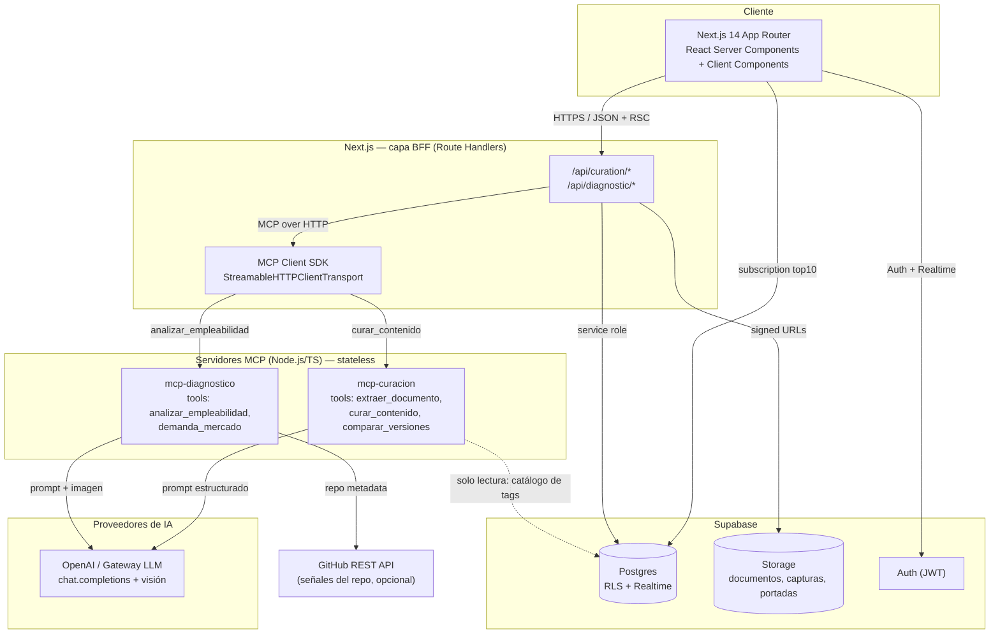
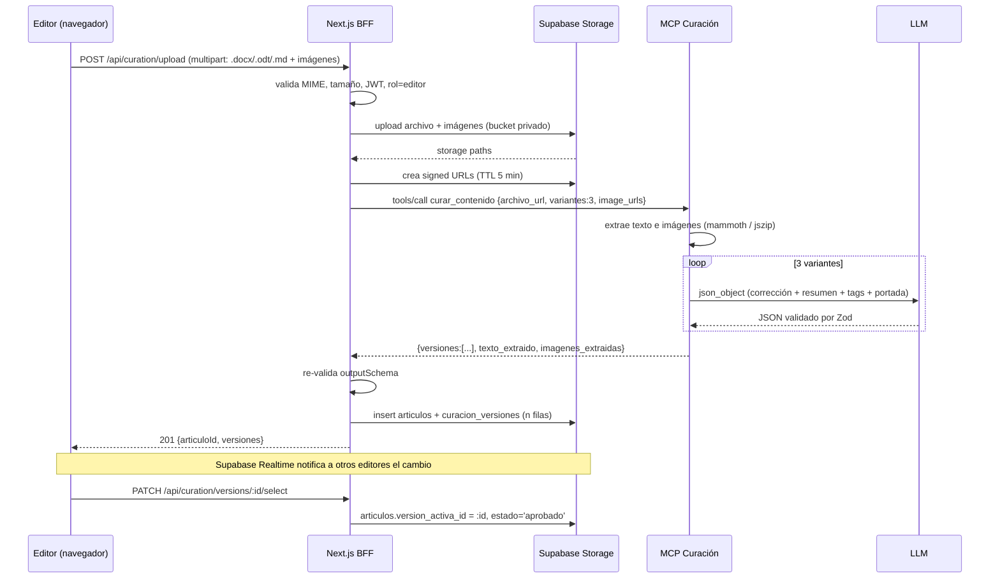
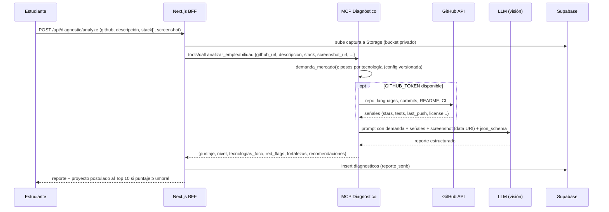

# Arquitectura — Talento Tech Valle (Revista Tech)

> **Nombre recomendado:** conserva **Talento Tech Valle** como marca paraguas (ya existe en el repo) y usa **Revista Tech Valle** como marca editorial. Alternativas: *Brújula Tech* (énfasis en orientación laboral) o *Nodo Tech* (énfasis en comunidad). Se descarta "Revista Tech" a secas por ser genérico y difícil de posicionar.

## 1. Principios de diseño

| Principio | Decisión |
|---|---|
| MCP como contrato, no como base de datos | Los servidores MCP son **stateless y puros**: reciben contenido, devuelven estructura validada. La persistencia la hace el BFF de Next.js en Supabase. |
| BFF (Backend-for-Frontend) | El navegador **nunca** habla con un MCP server ni con OpenAI. Solo habla con Route Handlers de Next.js. |
| Transporte | **Streamable HTTP** (spec MCP 2025-06-18). `stdio` queda descartado: exige proceso local por usuario. SSE legacy queda en desuso. |
| Salida tipada | Todo tool MCP declara `inputSchema`/`outputSchema` con Zod. El BFF re-valida con Zod antes de persistir. |
| Observabilidad | Cada llamada MCP lleva `requestId`, `modelo`, `promptVersion` y `tokens`. Se guarda en `curacion_versiones` / `diagnosticos`. |
| Multi-tenant | `editor_id` / `usuario_id` desde el JWT de Supabase. RLS + service-role solo en servidor. |

## 2. Diagrama de contexto (C4 nivel 1)



## 3. Flujo de curación (secuencia)



**Puntos clave del flujo**
- El archivo viaja una sola vez por HTTP (multipart). El MCP lo descarga por **signed URL de corta duración**, no por base64 gigante en JSON.
- Se generan **n variantes en una sola llamada** al tool (parámetro `variantes`), pero cada variante se persiste como fila independiente → historial real, con diff y selección.
- Regenerar es llamar de nuevo al tool con `variantes: n`; el `numero` de versión incrementa por trigger/secuencia, nunca sobrescribe.

## 4. Flujo de diagnóstico (secuencia)



## 5. Contrato de tools MCP

| Servidor | Tool | Input (Zod) | Output |
|---|---|---|---|
| Curación | `extraer_documento` | `archivo_url` \| `contenido_base64`, `mime` | `texto`, `imagenes[]`, `metadatos` |
| Curación | `curar_contenido` | `archivo_url`, `variantes` (1-5), `idioma`, `tags_actuales?` | `versiones[]{numero, titulo, contenido_md, resumen, tags, imagen_portada_sugerida, confianza}`, `modelo`, `prompt_version` |
| Curación | `comparar_versiones` | `versionA`, `versionB` | `diff_md`, `cambios[]` |
| Diagnóstico | `analizar_empleabilidad` | `github_url`, `descripcion`, `stack[]`, `screenshot_url?`, `nivel_ingles?` | `puntaje`, `nivel`, `tecnologias_foco[]`, `red_flags[]`, `fortalezas[]`, `recomendaciones[]`, `resumen` |
| Diagnóstico | `demanda_mercado` | `region?` | `tecnologias[]{nombre, demanda, salario_ref, tendencia}` |

También se exponen **resources** (`curacion://prompt/{version}`, `mercado://demanda/current`) para que un futuro agente orchestrador descubra prompts y datos sin acoplarse al código.

## 6. ¿Por qué MCP y no un simple REST interno?

1. **Intercambiabilidad:** el editor puede correr un MCP de curación distinto (ej. uno especializado en divulgación científica) sin tocar el BFF; basta cambiar `MCP_CURACION_URL`.
2. **Ecosistema:** cualquier cliente MCP (Claude Desktop, un agente de RRHH, un script de CI) puede consumir las mismas capacidades.
3. **Separación LLM/datos:** el prompt y la política de IA viven en el servidor MCP; las reglas de negocio y RLS viven en Supabase. Un cambio de proveedor de IA no migra datos.
4. **Escalado independiente:** los MCP son contenedores stateless → escalan horizontalmente (réplicas + cola) sin sesión pegajosa.

> Nota operativa: en MVP el BFF llama al MCP de forma síncrona. Para producción con documentos largos, el BFF encola el trabajo (Supabase Edge Function + pgmq / Redis) y el cliente usa Realtime para enterarse cuando las versiones están listas. El contrato MCP no cambia.

## 7. Seguridad

- **JWT de Supabase** verificado en cada Route Handler; `rol` (`editor` | `estudiante` | `admin`) chequeado antes de invocar tools.
- **Service role key** solo en servidor (`SUPABASE_SERVICE_ROLE_KEY`), nunca en `NEXT_PUBLIC_*`.
- **Signed URLs con TTL corto** para que el MCP lea archivos; sin credenciales de Storage dentro del MCP.
- **Validación de doble capa**: Zod en el tool MCP + Zod en el BFF antes de insertar.
- **Sanitización de Markdown** antes de renderizar (rehype-sanitize) para evitar XSS con contenido generado por LLM.
- **Rate limiting** por usuario en `/api/curation/*` y `/api/diagnostic/*` (dos llamadas/minuto en MVP).
- **Habeas Data (Ley 1581 de 2012)**: checkbox explícito de autorización antes de publicar proyecto o foto en el Top 10; columna `consentimiento_publicacion` en `proyectos`.
- **Secretos**: `GITHUB_TOKEN` y `OPENAI_API_KEY` inyectados por entorno; nunca logueados ni devueltos al cliente.

## 8. Estructura de carpetas resultante

```
├── docs/                      # este documento + plan de implementación
├── supabase/migrations/       # esquema SQL + RLS
├── mcp/
│   ├── shared/src/            # llm.ts, extract.ts, http.ts (paquete compartido)
│   ├── curation/src/index.ts  # servidor MCP de curación
│   └── diagnostic/src/        # servidor MCP de diagnóstico + demanda.ts
├── lib/
│   ├── supabase/              # clientes browser/server
│   ├── mcp-client.ts          # pool de clientes MCP en el BFF
│   ├── api-types.ts           # contratos Zod compartidos BFF <-> UI
│   └── types.ts               # tipos de dominio (existentes, extendidos)
├── app/api/                   # Route Handlers (BFF)
└── components/curation/       # DocumentUploader + CurationHistory
```
