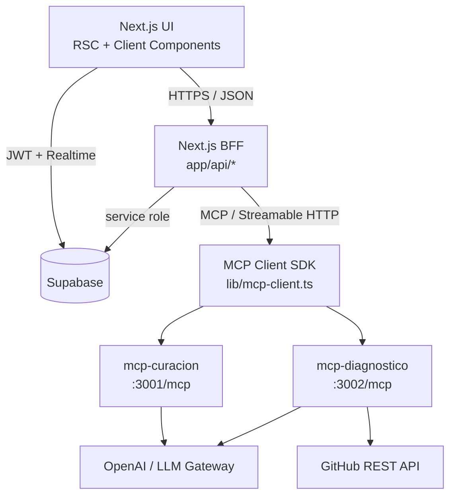

# Informe de implementación — Talento Tech Valle (Revista Tech Valle)

| Campo | Valor |
|---|---|
| Proyecto | Talento Tech Valle — plataforma web con arquitectura MCP |
| Fecha | 22 de noviembre de 2026 |
| Versión | Informe v1.0 (MVP arquitectónico) |
| Estado general | **Implementado y verificado en local**; pendiente de despliegue y de la UI del Top 10 |
| Repositorio base | Next.js 14 App Router + TypeScript + Tailwind (prototipo previo) |

---

## 1. Resumen ejecutivo

Se transformó el prototipo estático existente en una **base de código de producción** con tres capas claramente separadas:

1. **Cliente (Next.js 14):** Routes, componentes y formularios.
2. **BFF (Route Handlers en Next.js):** autenticación JWT, validación, persistencia y cliente MCP. Es el único punto que habla con Supabase y con los servidores de IA.
3. **Servidores MCP (Node.js/TypeScript, Streamable HTTP):** dos agentes stateless — *Curación* y *Diagnóstico* — que exponen tools con esquemas Zod y delegan el razonamiento a un LLM.

El cambio arquitectónico más importante es que **el MCP no persiste datos**: recibe contenido (o una signed URL), devuelve un objeto validado y el BFF decide qué guardar. Esto permite escalar los MCP horizontalmente, cambiar el proveedor de IA sin migrar datos y sustituir un agente por otro modificando solo una variable de entorno.

**Nombre recomendado:** *Talento Tech Valle* como marca paraguas y *Revista Tech Valle* como marca editorial. Se descarta "Revista Tech" por ser genérico.

---

## 2. Alcance y estado de los entregables

| # | Entregable solicitado | Estado | Evidencia |
|---|---|---|---|
| 1 | Diagrama de arquitectura y explicación de comunicación | ✅ Completo | `docs/01-arquitectura.md` (diagramas C4 y de secuencia Mermaid) |
| 2 | Esquema SQL (Usuarios, Artículos, Curación, Diagnósticos, Proyectos, Comentarios, Likes) | ✅ Completo | `supabase/migrations/0001_initial_schema.sql` (8 tablas + vista + RLS) |
| 3 | MCP de Curación con extracción y versiones | ✅ Completo | `mcp/curation/src/index.ts`, `mcp/shared/src/extract.ts` |
| 4 | MCP de Diagnóstico con reporte LLM | ✅ Completo | `mcp/diagnostic/src/index.ts`, `demanda.ts`, `github.ts` |
| 5 | UI de subida e historial de curación | ✅ Completo | `components/curation/*`, `app/editor/page.tsx` |
| 6 | Plan de implementación de 2 semanas | ✅ Completo | `docs/02-plan-implementacion.md` |
| — | BFF, contratos compartidos y configuración | ✅ Completo | `lib/*`, `app/api/*`, `.env.example`, `.eslintrc.json` |
| — | UI del módulo Top 10 | ⚠️ Parcial | Base de datos lista (`top10_semanal` + RLS); falta la interfaz |
| — | Formulario de diagnóstico conectado al MCP | ⚠️ Parcial | Endpoint listo; el componente actual aún usa scoring local |

---

## 3. Arquitectura implementada

### 3.1 Componentes y comunicación



- **Navegador → BFF:** peticiones HTTP estándar (`fetch` + Route Handlers).
- **BFF → Supabase:** `@supabase/ssr` para sesión con cookies y `@supabase/supabase-js` con service role para operaciones de servidor.
- **BFF → MCP:** `@modelcontextprotocol/sdk` con `StreamableHTTPClientTransport`, pool de conexiones por servidor y reintento ante fallo (`lib/mcp-client.ts:48`).
- **MCP → LLM:** `chat.completions` con `response_format: json_object`, validado con Zod. El cliente OpenAI se instancia de forma perezosa para que el servidor pueda arrancar y responder `/healthz` sin clave configurada.
- **MCP → archivos:** los documentos se suben una vez a Storage; el BFF firma URLs con TTL de 5 minutos y el MCP las descarga. Hay allowlist opcional de hosts (`MCP_ALLOWED_HOSTS`) para evitar SSRF.

### 3.2 Flujo de curación

1. El editor sube `.docx`, `.odt` o `.md` (máx. 20 MB) y hasta 5 imágenes.
2. El BFF valida MIME/tamaño/JWT/rol, guarda en el bucket privado `documentos` y genera signed URLs.
3. `curar_contenido` extrae texto e imágenes (`mammoth` para DOCX, `JSZip` + `fast-xml-parser` para ODT) y genera *n* variantes con enfoques distintos (conservador, equilibrado, divulgativo).
4. Cada variante se persiste como una fila inmutable en `curacion_versiones`; un trigger asigna el número correlativo.
5. El editor compara versiones (diff LCS en cliente), aprobar una actualiza `articulo.version_activa_id`, el contenido y el estado a `aprobado`.
6. "Regenerar" vuelve a invocar el MCP y añade más versiones sin sobrescribir las anteriores.

### 3.3 Flujo de diagnóstico

1. El estudiante envía GitHub, descripción, tecnologías, captura opcional y consentimiento.
2. El BFF sube la captura al bucket `capturas`, firma la URL y llama a `analizar_empleabilidad`.
3. El MCP consulta el catálogo de demanda regional (14 tecnologías con peso, tendencia y salario de referencia), obtiene señales objetivas de GitHub (stars, lenguajes, README, tests, CI, licencia, último push) y envía la captura al LLM con visión.
4. El LLM devuelve un reporte con puntaje, nivel, tecnologías foco, red flags, fortalezas y recomendaciones.
5. El BFF persiste el reporte en `diagnosticos` y, si el puntaje ≥ 75 y hay consentimiento explícito, crea el proyecto postulable al Top 10.

### 3.4 Decisiones técnicas

| Decisión | Justificación |
|---|---|
| MCP stateless, sin acceso a BD | Permite réplicas sin sesión pegajosa y separa IA de reglas de negocio/RLS. |
| Streamable HTTP (spec 2025-06-18) | `stdio` exige proceso local; SSE legacy está en desuso. HTTP es la opción remota recomendada. |
| Zod en MCP **y** en BFF | Doble validación: protege al agente de entradas malas y a la BD de salidas del LLM mal formadas. |
| Signed URLs de 5 min en vez de base64 | Evita pasar archivos binarios grandes dentro de mensajes JSON. |
| Numeración por trigger | El historial de curaciones es inmutable: regenerar nunca sobrescribe. |
| Service role solo en servidor | Ninguna credencial privada se expone con prefijo `NEXT_PUBLIC_*`. |
| Reporte `jsonb` + columnas derivadas | Conserva la respuesta completa del LLM y permite consultar puntaje/red flags sin parsear. |

---

## 4. Detalle de módulos

### 4.1 Módulo Revista (editorial y curación)

- Subida drag & drop con validación de extensión y tamaño (`DocumentUploader.tsx`).
- Extracción real de DOCX/ODT/Markdown con imágenes incrustadas.
- Corrección ortográfica y de redacción, resumen, tags y portada sugerida. Si no hay imágenes, el LLM devuelve un *prompt* de portada en lugar de una URL.
- Historial con lista de versiones, confianza, modelo, prompt version, tags, diff y aprobación (`CurationHistory.tsx`).
- Regeneración bajo demanda con 2 versiones adicionales.
- Ruta de trabajo: `/editor`.

### 4.2 Módulo Diagnóstico (empleabilidad)

- Herramienta `demanda_mercado`: catálogo versionado con 14 tecnologías.
- Herramienta `analizar_empleabilidad`: calibra 55% stack vs. demanda, 25% calidad evidenciable, 20% captura e inglés; resta puntos por red flags confirmadas.
- Degradación elegante: sin `GITHUB_TOKEN`, `github_signals` es `null` y el LLM trabaja solo con la descripción.
- Endpoint `POST /api/diagnostic/analyze` con persistencia y postulación condicional al Top 10.

### 4.3 Módulo Top 10 Emprendiendo

- `proyectos` con `consentimiento_publicacion` (Ley 1581) y `destacado_semana`.
- `likes`, `calificaciones` (1–5 estrellas) y `comentarios` con claves primarias compuestas para evitar duplicados.
- Vista `top10_semanal con (security_invoker = true)`: ranking de los últimos 7 días ponderando likes ×2, comentarios ×3 y estrellas ×5.
- RLS: lectura pública solo de proyectos con consentimiento; escritura autenticada y dueño de la interacción.
- **Pendiente:** componentes de feed, likes, estrellas, comentarios y suscripción Realtime.

---

## 5. Contrato de tools MCP

| Servidor | Tool | Entrada relevante | Salida |
|---|---|---|---|
| Curación | `extraer_documento` | `archivo_url` o `contenido_base64`, `mime` | `texto`, `imagenes[]`, `metadatos` |
| Curación | `curar_contenido` | `archivo_url`, `variantes` (1–5), `image_urls`, `tags_actuales` | `versiones[]`, `texto_extraido`, `modelo`, `prompt_version`, `tokens_totales` |
| Curación | `comparar_versiones` | `versionA`, `versionB`, etiquetas | `diff_md` (unified) |
| Diagnóstico | `demanda_mercado` | `region` | `tecnologias[]` con demanda, tendencia y salario |
| Diagnóstico | `analizar_empleabilidad` | `github_url`, `descripcion`, `stack[]`, `screenshot_url`, `nivel_ingles` | `puntaje`, `nivel`, `tecnologias_foco[]`, `red_flags[]`, `fortalezas[]`, `recomendaciones[]`, `postulable_top10`, `github_signals` |

---

## 6. Base de datos

| Tabla | Propósito | Control de acceso |
|---|---|---|
| `usuarios` | Perfil extendido de `auth.users` con rol | Público; solo el dueño edita |
| `articulos` | Artículo, estado y versión activa | Publicados son públicos; borradores solo su editor |
| `curacion_versiones` | Historial inmutable de curaciones | Legible con el artículo; escribe su editor |
| `diagnosticos` | Reporte JSONB del MCP | Privado del estudiante |
| `proyectos` | Emprendimientos postulables | Públicos solo con consentimiento |
| `comentarios` | Comentarios del feed | Lectura pública; escritura propia |
| `likes` | Me gusta (PK compuesta) | Lectura pública; escritura propia |
| `calificaciones` | Estrellas 1–5 (PK compuesta) | Lectura pública; escritura propia |
| `top10_semanal` (vista) | Ranking semanal | `security_invoker` |

Incluye además buckets de Storage (`documentos`, `capturas`, `portadas`), trigger de `updated_at`, numeración automática de versiones y funciones `security definer` para roles.

---

## 7. Seguridad y cumplimiento

- JWT verificado en cada Route Handler; roles `editor`/`admin` exigidos en curación.
- Service rolekey exclusivamente en servidor; signed URLs de corta duración para que el MCP lea archivos.
- Validación Zod en dos capas y allowlist de hosts para descargas.
- Sanitización de Markdown pendiente para evitar XSS con contenido generado por IA.
- Consentimiento explícito de publicación (Habeas Data, Ley 1581 de 2012) antes de mostrar un proyecto o foto en el feed.
- Secretos inyectados por entorno, nunca logueados ni devueltos al cliente.

---

## 8. Verificación realizada

| Prueba | Comando | Resultado |
|---|---|---|
| Typecheck app | `npx tsc --noEmit` | ✅ Sin errores |
| Typecheck MCP curación | `npx tsc --noEmit -p tsconfig.json` | ✅ Sin errores |
| Typecheck MCP diagnóstico | `npx tsc --noEmit -p tsconfig.json` | ✅ Sin errores |
| Lint | `npm run lint` | ✅ Sin warnings ni errores |
| Build de producción | `npm run build` | ✅ Compilado; 12 rutas generadas |
| Listado de tools | Cliente SDK contra `:3001/mcp` y `:3002/mcp` | ✅ 5 tools expuestos |
| `extraer_documento` | Markdown en base64 | ✅ `formato: md`, texto extraído |
| `comparar_versiones` | Dos textos de prueba | ✅ diff unified generado |
| `demanda_mercado` | `region: valle` | ✅ 14 tecnologías, `structuredContent` válido |

Nota: el build se ejecutó con `NEXT_FONT_GOOGLE_MOCKED_RESPONSES` porque el entorno no tiene acceso a Google Fonts. Es una limitación del entorno de verificación, no del código; el proyecto usa `next/font/google` en `app/layout.tsx`.

---

## 9. Estado actual y deuda técnica

**Listo para usar:** arquitectura, SQL, ambos MCP, BFF y UI editorial.

**Pendiente para el MVP completo (días 7–10 del plan):**

1. Conectar `DiagnosticForm` a `POST /api/diagnostic/analyze` (sustituir `computeScore` local) y mostrar el reporte estructurado.
2. Implementar el feed del Top 10 con Realtime, likes, estrellas y comentarios.
3. Añadir `rehype-sanitize` antes de renderizar Markdown generado por IA.
4. Añadir reintento de `completeJson` ante JSON inválido y rate limiting por usuario.
5. Para documentos largos: encolar la curación y notificar por Realtime en lugar de esperar la respuesta HTTP.
6. Desplegar MCP en Fly.io/Railway, Next.js en Vercel y aplicar la migración en Supabase.

---

## 10. Puesta en marcha

```bash
cp .env.example .env.local

npm install && npm run dev

cd mcp/curation && npm install && npm run dev
cd mcp/diagnostic && npm install && npm run dev
```

Aplicar `supabase/migrations/0001_initial_schema.sql` en el SQL Editor de Supabase o con `supabase db push`. Rutas: `/editor` (curación), `/diagnostico` (prototipo actual), `/revista` (visor).

---

## Anexo A — Inventario de archivos

| Archivo | Rol |
|---|---|
| `docs/01-arquitectura.md` | Arquitectura, diagramas y contrato MCP |
| `docs/02-plan-implementacion.md` | Sprint de 2 semanas |
| `docs/03-informe-implementacion.md` | Este informe |
| `informe-implementacion.html` | Versión HTML de este informe |
| `supabase/migrations/0001_initial_schema.sql` | Esquema, RLS y Storage |
| `mcp/shared/src/llm.ts` | Cliente OpenAI perezoso con salida JSON validada |
| `mcp/shared/src/extract.ts` | Extracción DOCX/ODT/MD e imágenes |
| `mcp/shared/src/http.ts` | Descarga segura de signed URLs |
| `mcp/curation/src/index.ts` | Servidor MCP de curación |
| `mcp/diagnostic/src/index.ts` | Servidor MCP de diagnóstico |
| `mcp/diagnostic/src/demanda.ts` | Catálogo de demanda regional |
| `mcp/diagnostic/src/github.ts` | Señales objetivas de GitHub |
| `lib/auth.ts` | JWT, roles y respuestas de error |
| `lib/api-types.ts` | Esquemas Zod compartidos |
| `lib/mcp-client.ts` | Pool de clientes MCP con reintento |
| `lib/supabase/{client,server}.ts` | Clientes browser/server/admin |
| `app/api/curation/upload/route.ts` | Subida y primera curación |
| `app/api/curation/generate/route.ts` | Regeneración de versiones |
| `app/api/curation/versions/route.ts` | Listado de historial |
| `app/api/curation/versions/[id]/select/route.ts` | Aprobación de versión |
| `app/api/diagnostic/analyze/route.ts` | Diagnóstico y postulación |
| `components/curation/DocumentUploader.tsx` | Subida drag & drop |
| `components/curation/CurationHistory.tsx` | Historial, diff y aprobación |
| `components/curation/EditorWorkspace.tsx` | Composición del estudio editorial |
| `app/editor/page.tsx` | Ruta del editor |
| `.env.example`, `.eslintrc.json` | Configuración |

## Anexo B — Variables de entorno

| Variable | Uso |
|---|---|
| `NEXT_PUBLIC_SUPABASE_URL`, `NEXT_PUBLIC_SUPABASE_ANON_KEY` | Cliente y sesión |
| `SUPABASE_SERVICE_ROLE_KEY` | Operaciones de servidor (BFF) |
| `MCP_CURACION_URL`, `MCP_DIAGNOSTICO_URL` | Endpoints Streamable HTTP |
| `OPENAI_API_KEY`, `OPENAI_BASE_URL` | Proveedor de LLM |
| `CURACION_MODEL`, `DIAGNOSTICO_MODEL` | Modelos por agente |
| `MCP_ALLOWED_HOSTS` | Allowlist opcional de signed URLs |
| `GITHUB_TOKEN` | Opcional; amplía límites de la API de GitHub |
